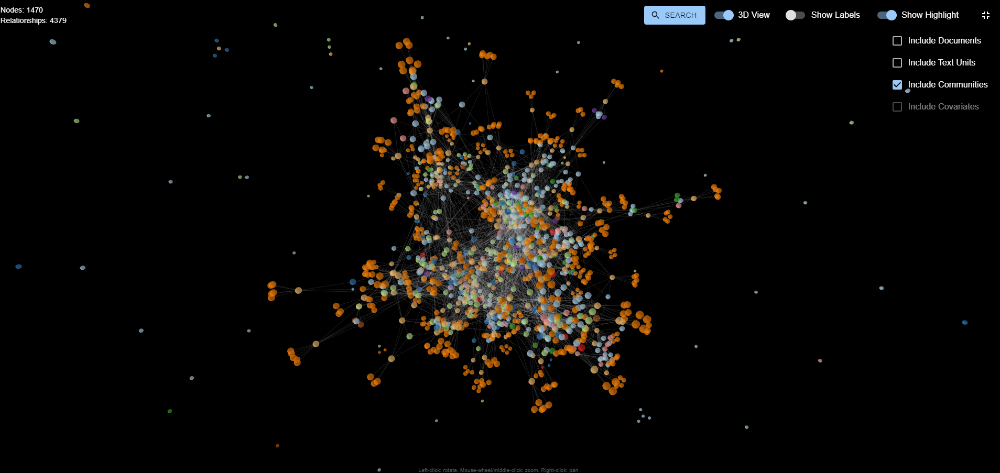
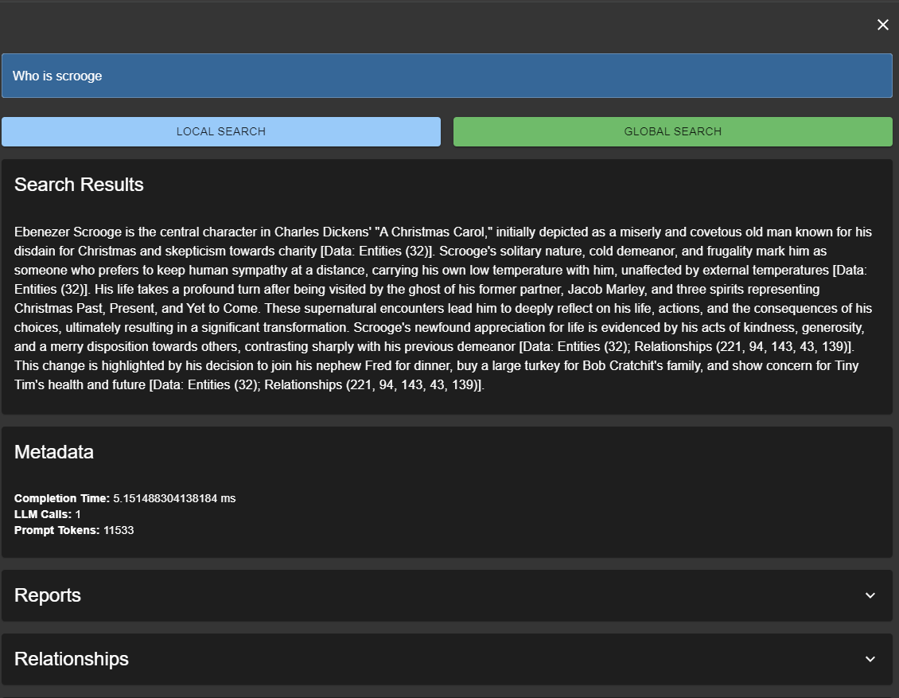

# GraphRAG Visualizer

👉 [GraphRAG Visualizer](https://noworneverev.github.io/graphrag-visualizer/)<br/>
👉 [GraphRAG Visualizer Demo](https://www.youtube.com/watch?v=Hjx1iTZZtzw)



## Overview

GraphRAG Visualizer is an application designed to visualize Microsoft [GraphRAG](https://github.com/microsoft/graphrag) artifacts. By uploading parquet files generated from the GraphRAG indexing pipeline, users can easily view and analyze data without needing additional software or scripts.

## Important Note

If you are using **GraphRAG 0.3.x or below**, please use the legacy version of GraphRAG Visualizer available at:  
👉 [GraphRAG Visualizer Legacy](https://noworneverev.github.io/graphrag-visualizer-legacy)

## Features

- **Graph Visualization**: View the graph in 2D or 3D in the "Graph Visualization" tab.
- **Data Tables**: Display data from the parquet files in the "Data Tables" tab.
- **Search Functionality**: Fully supports search, allowing users to focus on specific nodes or relationships.
- **Local Processing**: All artifacts are processed locally on your machine, ensuring data security and privacy.

## Graph Controls

The drawing fills the space below the navigation bar and resizes with the window. **Full Screen** uses the whole browser viewport. The camera fits the graph after the layout stops and after a resize. You can also use **Fit graph to screen** at any time.

Dark mode is on by default. Use **Switch to dark mode** or **Switch to light mode** in the graph controls or page header. The choice is saved. The canvas, labels, and controls follow the selected theme, including in full screen.

- **Max Entities** selects the entities with the most relationships. The graph updates when you release the slider.
- **Max total nodes** limits all node types. Entities come first, followed by documents, text units, communities, findings, and covariates. A value of `0` keeps all nodes allowed by Max Entities and the inclusion controls.
- **Max total links** limits links between the retained nodes. A value of `0` keeps all valid links. Set these two limits with Enter or by leaving the field.
- **Link spacing** sets the target link distance from `0.25×` to `10×`. Start with `2×` or `3×` if nodes are too close. Release the slider to apply the value and restart the layout in 2D or 3D. This sets a target distance; it does not guarantee that nodes cannot overlap.
- 3D uses thin base links. Highlighted links change color. Particles run only on highlighted links, with a limit of 100 animated links. Labels are created only when enabled. Keep labels off when you view a large graph.
- **Show high degree hubs** restores nodes with at least 50 neighbors or 20% of the nodes, whichever is greater. These hubs and their links are hidden by default. This changes the view, not the source data.
- Individual nodes are shown by default. **Show group overview**, beside the counts, uses saved communities when available. Otherwise, automatic mode groups by entity type if there is more than one type. Click a named group dot to expand it. Group labels stay visible when ordinary node labels are off. **Show individual nodes** restores the full view. **Group by** and the group controls provide more choices. Links between groups combine source links of the same type and direction. Links inside a collapsed group are hidden.
- **Link types** selects the relationship types to draw. Saved relationship types are preserved. Files without a type use `RELATED`.
- Select a node, then use **Show selected node and neighbors** to inspect its direct connections. This view follows the hub and link filters. **Show overview** returns to the previous group view. **Fit graph to screen** adjusts the camera.
- Loaded entity and relationship counts describe the input files. The counts before view filters include the entity and total limits. Visible counts describe the current drawing. Screen distance does not measure meaning or importance.
- Community group names use descriptive report titles first, then descriptive community titles. If both titles are absent or contain only a number, the label lists up to three member names, with the most connected members first. These fallback labels describe membership; they do not assign a new topic.

### Load One Export

Select one output folder. Do not select a parent folder that contains several exports. The loader rejects multiple files for the same data type, duplicate row ids, and duplicate entity titles. A new selection replaces the previous export. If loading fails, the previous data stays available and an error is shown.

Use **Loaded files** to check file paths and row counts. Default loading prefers current filenames such as `entities.parquet` over legacy filenames such as `create_final_entities.parquet`. A file that finishes loading late cannot replace a newer selection.

## Using the Search Functionality

Once the [graphrag-api](https://github.com/noworneverev/graphrag-api) server is up and running, you can perform searches directly through the GraphRAG Visualizer. Simply go to the [GraphRAG Visualizer](https://noworneverev.github.io/graphrag-visualizer/) and use the search interface to query the API server. This allows you to easily search and explore data that is hosted on your local server.



## Graph Data Model

The logic for creating relationships for text units, documents, communities, and covariates is derived from the [GraphRAG import Neo4j Cypher notebook](https://github.com/microsoft/graphrag/blob/main/examples_notebooks/community_contrib/neo4j/graphrag_import_neo4j_cypher.ipynb).

### Nodes

| Node      | Type           |
| --------- | -------------- |
| Document  | `RAW_DOCUMENT` |
| Text Unit | `CHUNK`        |
| Community | `COMMUNITY`    |
| Finding   | `FINDING`      |
| Covariate | `COVARIATE`    |
| Entity    | _Varies_       |

### Relationships

| Source Node | Relationship    | Target Node |
| ----------- | --------------- | ----------- |
| Entity      | `RELATED`       | Entity      |
| Text Unit   | `PART_OF`       | Document    |
| Text Unit   | `HAS_ENTITY`    | Entity      |
| Text Unit   | `HAS_COVARIATE` | Covariate   |
| Community   | `HAS_FINDING`   | Finding     |
| Entity      | `IN_COMMUNITY`  | Community   |

## Developer Instructions

### Setting Up the Project

1. Clone the repository to your local machine:

   ```bash
   git clone https://github.com/noworneverev/graphrag-visualizer.git
   cd graphrag-visualizer
   ```

2. Install the necessary dependencies:

   ```bash
   npm install
   ```

3. Run the development server:

   ```bash
   npm start
   ```

4. Open the app in your browser:
   ```
   http://localhost:3000
   ```

### Loading Parquet Files

To load `.parquet` files automatically when the application starts, place your Parquet files in the `public/artifacts` directory. These files will be loaded into the application for visualization and data table display. The files can be organized as follows:

- GraphRAG v2.x.x
  - `public/artifacts/entities.parquet`
  - `public/artifacts/relationships.parquet`
  - `public/artifacts/documents.parquet`
  - `public/artifacts/text_units.parquet`
  - `public/artifacts/communities.parquet`
  - `public/artifacts/community_reports.parquet`
  - `public/artifacts/covariates.parquet`

- GraphRAG v1.x.x
  - `public/artifacts/create_final_entities.parquet`
  - `public/artifacts/create_final_relationships.parquet`
  - `public/artifacts/create_final_documents.parquet`
  - `public/artifacts/create_final_text_units.parquet`
  - `public/artifacts/create_final_communities.parquet`
  - `public/artifacts/create_final_community_reports.parquet`
  - `public/artifacts/create_final_covariates.parquet`

If the files are placed in the `public/artifacts` folder, the app will automatically load and display them on startup.
